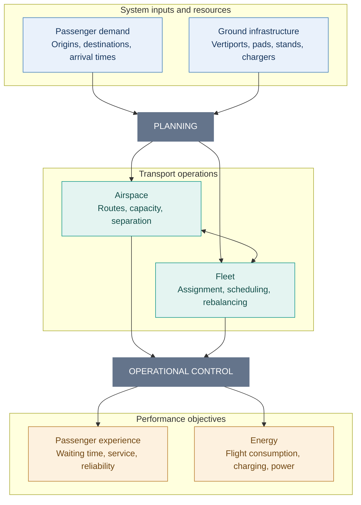

**NATS - Urban Air Mobility Problem**: mathematical modelling and optimisation of an urban air taxi network based on electric vertical take-off and landing (eVTOL) aircraft.

**Source**: NATS – MDM3 Problem
## 1. What is the main goal?

To design and optimise a safe, reliable, energy-efficient and operationally feasible urban air mobility (UAM) system capable of transporting as many passengers as possible throughout an operating day.

The system must coordinate passenger demand, aircraft, airspace routes, vertiport infrastructure and energy resources. The aim is to identify which combinations of infrastructure and operational policies provide the best overall performance, rather than optimise each component in isolation.

Safety and mandatory energy reserves should be treated as hard constraints. Passenger throughput, quality of service, energy efficiency and infrastructure utilisation are performance objectives.

## 2. Which are the two questions we can tackle?

The NATS presentation (slide 11) explicitly identifies two overarching questions:

1. **System design and feasibility:** What combination of routes, flight schedules, separation arrangements and ground infrastructure would enable a safe, resilient and operationally feasible eVTOL service?
2. **Operational capacity:** How can we determine the flight schedule and infrastructure needed to carry the greatest number of passengers safely and reliably during one operating day?

The first question concerns the configuration and coordination of the system; the second concerns its achievable passenger throughput and the resources required to deliver it. They are closely related: infrastructure and airspace constraints determine which schedules are feasible, while operational performance informs infrastructure design.

## 3. What are the dimensions of our problem?

The problem can be decomposed into six interconnected dimensions:

| Dimension                 | Main considerations                                                                                                                  |
| ------------------------- | ------------------------------------------------------------------------------------------------------------------------------------ |
| **Passenger demand**      | Origin–destination requests, temporal demand patterns, number of passengers and demand imbalance.                                    |
| **Ground infrastructure** | Location and capacity of vertiports, take-off and landing pads, parking stands, charging stations and passenger boarding facilities. |
| **Airspace**              | Flight corridors, travel times, airspace capacity, separation requirements and conflicts with other traffic.                         |
| **Fleet**                 | Number and availability of aircraft, passenger assignment, flight schedules, empty flights and fleet rebalancing.                    |
| **Passenger experience**  | Waiting times, journey duration, service availability, reliability and accessibility.                                                |
| **Energy**                | Aircraft energy consumption, battery state of charge, charging schedules and infrastructure power demand.                            |

**Decentralisation** is a cross-cutting dimension of the problem: it determines how information is shared and how decisions are made and coordinated across these six components.

## 4. What are the scales of the problem?

| Scale | Time horizon | Main decisions |
| --- | --- | --- |
| **Strategic** | Months to years | Design of the transport network, location of vertiports, fleet size, number of pads and chargers, and airspace organisation. |
| **Tactical** | Hours to days | Flight scheduling, allocation of aircraft and resources, fleet rebalancing, charging schedules and capacity planning. |
| **Operational** | Seconds to minutes | Real-time passenger assignment, departure and arrival sequencing, rescheduling, conflict management and responses to disruptions. |

A reasonable initial scope is to focus on **tactical** and **operational** optimisation within a fixed hypothetical network. Strategic decisions can initially be investigated through scenario and sensitivity analysis.

## 5. Which mathematical problems are involved?

Because this problem is mostly new for us, it is important to know the mathematical areas that are involved in the modelling of this problem.
### 5.1. Transport network design

Represent the city as a directed graph $G=(V,E)$, where vertices represent vertiports or navigation points and edges represent permitted flight corridors. Edges may have travel times, energy costs and capacity restrictions.

**Research questions:** What network topology provides the best connectivity? Which routes or vertiports become bottlenecks? How does the network respond to the loss of a connection?

**Mathematical areas:** Graph theory, network design, facility location, network optimisation, shortest-path problems and network resilience.

### 5.2. Dynamic fleet management

Determine how aircraft move through the network over time, including passenger-carrying flights, waiting and empty relocation flights. Spatial and temporal imbalances in passenger demand create a need for **fleet rebalancing**.

**Research questions:** How many aircraft are needed? Where should idle aircraft be positioned? Should rebalancing anticipate future demand? How can empty flights be reduced?

**Mathematical areas:** Dynamic network flows (flows over time), time-expanded networks, minimum-cost flows, vehicle routing, optimal transport, mixed-integer programming and model predictive control (MPC).

### 5.3. Vertiport operations and resource scheduling

A vertiport consists of interacting resources with finite capacities: take-off and landing areas (TLOFs), parking stands, chargers and passenger boarding facilities. Operations must be sequenced while respecting capacity, precedence and non-overlap constraints.

NATS (slides 12–13) proposes queueing models such as $M/M/1$ or $M/M/1/K$ for TLOF operations and $M/M/c/c$ for finite parking capacity without surface waiting, together with a CP-SAT scheduling formulation.

**Research questions:** How many aircraft can a vertiport process per hour? Is an additional pad, stand or charger more valuable? How do delays propagate between resources?

**Mathematical areas:** Queueing theory, queueing networks, stochastic processes, discrete-event simulation, job-shop scheduling and constraint programming (CP-SAT).

### 5.4. Air traffic management and separation

Aircraft must share corridors and airspace resources without violating the required separation constraints. A high-level network model can represent these constraints through capacities and reservations; more detailed models may include conflicts at intersections and temporal separation between individual flights.

**Research questions:** How do different separation assumptions affect throughput? How should aircraft coordinate the use of shared corridors? When should departures be delayed on the ground rather than aircraft being held in the air?

**Mathematical areas:** Air traffic flow management (ATFM), conflict graphs, multi-agent path finding (MAPF), combinatorial optimisation, resource allocation, scheduling and optimal control.

### 5.5. Passenger experience and service optimisation

Passenger throughput alone does not determine service quality. The system should also account for waiting times, total journey duration, unmet demand, cancellations and reliability.

**Research questions:** Should aircraft depart immediately or wait for more passengers? Can passengers with compatible destinations share a flight? How can we prevent low-demand areas from receiving systematically worse service?

**Mathematical areas:** Matching theory, dynamic ride-pooling, dial-a-ride problems, queueing theory, multi-objective optimisation and fairness in optimisation.

### 5.6. Energy optimisation and charging infrastructure

Flight energy consumption and battery state of charge constrain the feasible movements of aircraft. Charging decisions interact with fleet availability, vertiport congestion and the electrical capacity of the infrastructure.

**Research questions:** When and where should aircraft recharge? How can energy consumption from empty flights and airborne holding be reduced? How should charging be coordinated to avoid peak power demand? What is the trade-off between energy efficiency and passenger waiting times?

**Mathematical areas:** Energy-aware routing, electric vehicle routing problems (EVRP), resource-constrained shortest paths, space–time–energy networks, charging optimisation, convex optimisation and optimal control.

## 6. What do our supervisors care about?

Based on our initial discussion, the supervisors appear to be particularly interested in the following four aspects. These are discussion priorities, rather than a formally agreed project specification.

| Priority                         | What we should investigate                                                                                                                                                                                                                                       |
| -------------------------------- | ---------------------------------------------------------------------------------------------------------------------------------------------------------------------------------------------------------------------------------------------------------------- |
| **Passenger experience**         | Improve waiting times, reliability, accessibility and overall service quality, while satisfying as much demand as possible.                                                                                                                                      |
| **Energy efficiency**            | Optimise flight energy consumption, fleet rebalancing, charging schedules and the energy requirements of ground infrastructure.                                                                                                                                  |
| **Decentralised coordination**   | Investigate whether local decisions by aircraft, vertiports or operators can replace or complement centralised scheduling. Compare performance, scalability, communication requirements and robustness, while preserving shared resource and safety constraints. |
| **Useful modelling assumptions** | Identify abstractions that preserve the essential dynamics of the system while making the mathematical formulation and computational experiments tractable.                                                                                                      |
| **Innovation**                   | Have innovative ideas on some key aspects.                                                                                                                                                                                                                       |

The NATS presentation additionally makes safety, resilience, operational feasibility and daily passenger throughput explicit objectives or requirements. These should remain central to the project regardless of the optimisation architecture.